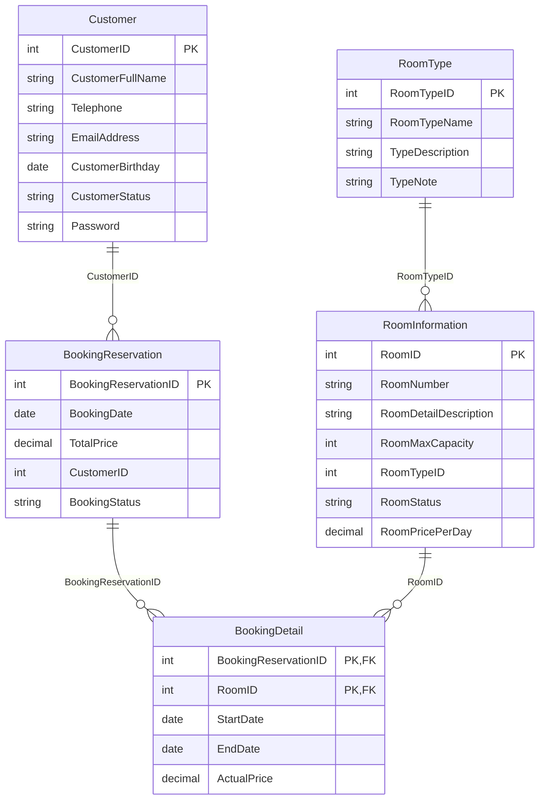

logo: FPT University | logo: Java

## **Assignment 03 SBA301 - Securing REST Services with Spring Boot**

### **1. Introduction**

Hotel Management System (HMS) can help you streamline and automate various aspects of managing a hotel. It can help you keep track of room reservations, bills, guest information, and financial transactions. The HMS can also help you manage housekeeping and maintenance tasks, as well as track inventory and purchase orders. Building an HMS can also help you improve customer satisfaction by providing them with a user-friendly interface to book rooms and manage their stays. Here are some key components and functions of a Hotel Management System

* Online Booking and Reservation: The system allows customers to make bookings and reservations online through a user-friendly interface. It provides real-time availability of vehicles, rental rates, and booking confirmations.
* Room Management: Room management in a hotel management system refers to the process of efficiently and effectively managing the rooms and their occupants in a hotel.
* Customer Management: The system maintains a database of customer information, including contact details, identification documents, and room booking history. It enables easy retrieval of customer records, communication, and personalized service.

Imagine you're a developer of a FU Mini Hotel Management System named **FUMiniHotelSystem**. To implement a part of this system your tasks include:

* Manage customer information.
* Manage room information.
* Manage online/offline booking transaction.

The application has to support adding, viewing, modifying, and removing information - a standardized usage action verb better known as Create, Read, Update, Delete (CRUD) and Search.

*This assignment explores*

1 | Page

* Create a RESTful API using **Spring Boot** 3 with MS SQL Server. An **SQL Server Database** will be created to persist the news data (reading and managing) by **Spring Data JPA.**
* Secure RESTful API using JSON Web Token.
* React Client sends HTTP requests and retrieve HTTP responses using axios, shows data on the components.

**2 |** P a g e
2

logo: FPT University | logo: Java

## **2. Assignment Objectives**

In this assignment, you will:

* Use the **IntelliJ IDEA** to create Spring Initializr Project (Maybe you can create the Spring Initializr project in <u>https://start.spring.io/</u> then open this project in IntelliJ IDEA.
* Choose **Spring Web** for Building web, including *RESTful*, applications using Spring MVC. Uses Apache Tomcat as the default embedded container. **Spring Data JPA SQL for** persisting data in SQL stores with Java Persistence API using Spring Data and Hibernate. **MS SQL Server Driver SQL** - A JDBC and R2DBC driver that provides access to Microsoft SQL Server and Azure SQL Database from any Java application. **Spring Security** and JWT for securing the RESTful API.
* Use in SQL Server Database as a Data Source
* Develop 3-Layer with Repository Architecture to perform CRUD actions using RESTful API with Spring Boot 3.
* React Client sends HTTP requests and retrieve HTTP responses using axios, shows data on the components.
* Apply to validate data type for all fields.
* Test the Spring REST API using Postman.
* Run the project and test the FE, BE interactions.

3 | P a g e

## **3. Database Design**

A part of MiniHotel System Database

*   A room will belong to only one room type.
*   A customer can make booking reservation in this system many times.
*   A booking reservation will have one or many room information. A room information will belong to many booking reservations.

**4 |** P a g e

logo: FPT University | logo: Java

## **4. Main Functions**

* *Do not need authentication to view the room information in this system.*
* Customer authentication by Email and Password using JSON Web Token.
* The Staff account will get from **application.properties** file.
* Use Spring Data JPA to create the database.
* Create **Spring REST API**:
    - **“Staff”** role:
        - Manage customer information.
        - Manage room information. (The delete action will delete room information in the case this information is not belong to any renting transaction. If the room information is already stored in a booking detail, just change the status.)
        - Manage booking reservation (includes booking details)
    - If user is a **Customer**, this customer role is allowed to:
        - Register an account
        - Create an online booking reservation with one or many rooms’ information.
        - Manage his/her the profile.
        - View booking reservation history.
* Create Client application (using ReactJS) interactive with **Spring REST API** to perform these functions:
    - **“Staff”** role:
        - Manage customer information.
        - Manage room information. (The delete action will delete room information in the case this information is not belong to any renting transaction. If the room information is already stored in a booking detail, just change the status.)
        - Manage booking reservation (includes booking details)

5 | Page

o If user is a **Customer**, this customer role is allowed to:

*   Register an account
*   Create an online booking reservation with one or many rooms’ information.
*   Manage his/her the profile.
*   View booking reservation history.

## **5. Note**

*   To do your BE program, you must use **Spring REST API** using 3-Layer Architecture.
*   The database named **A3StudentName_ClassCode**
*   Create Spring Initializr Project named **A3StudentName_ClassCode**,
*   Create ReactJS Project named **A3StudentName_ClassCode**.

**6 |** P a g e